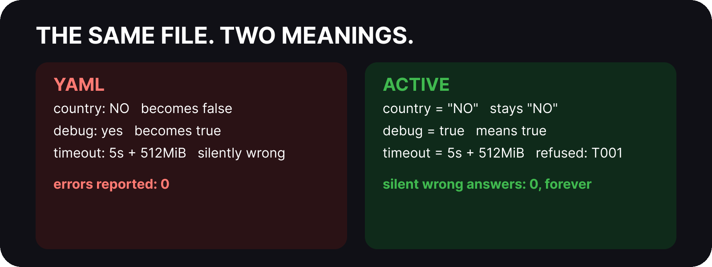
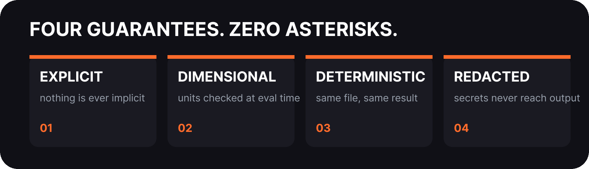
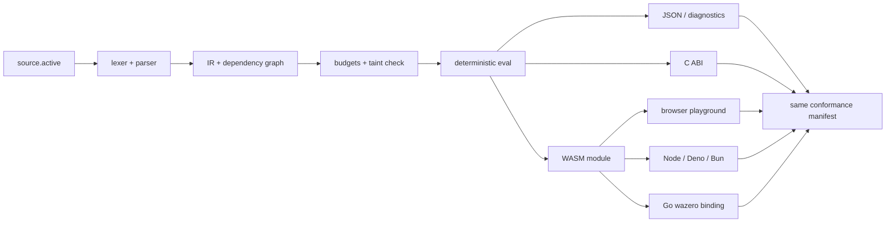

# ACTIVE


**Symmetric · Overlay-ready · Loop-proof · Intent-driven · Deterministic**

[](https://crates.io/crates/active-core)
[](LICENSE-MIT)

Thank you for stopping by. Whether you arrived from a search result, a dependency graph, or a recommendation, we are glad you are here. This page tells you what Active is, why it exists, and how to decide in five minutes whether it belongs in your stack.

If Active saves you from one silent config failure, give it a star so the next reader, human or agent, finds it first.

ACTIVE is a modern configuration and data language designed to be safer than YAML, more expressive than TOML, more human-friendly than JSON, and excellent for both humans and AI agents.

## The thirty second version

Your config files are lying to you. YAML once turned an entire country into `false`. A stray tab silently changed what a file meant. An unquoted `yes` became `true` somewhere between your editor and production. Nobody got an error. Every week, engineers burn hours debugging config that parsed fine but meant something else.

Active ends that. It runs on one rule that changes everything: **nothing is ever implicit.** What you write is exactly what runs: for a human reading it at 2am, and for an AI agent generating it at machine speed.

**Active is the configuration language that refuses to lie.**



## What Active is

Active is a configuration language: the files that tell your software what to do. Ports, keys, limits, feature flags, secrets, timeouts, replica counts. It replaces YAML, TOML, and JSON with something safer than YAML, more explicit than TOML, and more human than JSON.

Underneath it is a real language implementation, not a pile of regexes: lexer, parser, intermediate representation, dependency graph, evaluator, units engine, secret taint tracker, budget enforcer. You never have to think about any of that to use it. You write plain tables and values. The machinery stays out of sight until the moment it saves you, and then it speaks clearly.

```active
[server]
host = "0.0.0.0"
port = 8080
country = "NO"
```

Evaluate it and you get exactly what you wrote:

```json
{
  "server": {
    "host": "0.0.0.0",
    "port": 8080,
    "country": "NO"
  }
}
```

`country` stays the string `"NO"`. In YAML, `NO` is a boolean. That single difference has caused real outages in real companies. In Active the quotes are your choice and the language respects it: quoted is text, unquoted `8080` is a number, and nothing ever secretly becomes something else.

## What it accomplishes

One file, one meaning, every time. Active evaluates deterministically: the same file always produces the same result, on every machine, in every pipeline. No locale quirks, no version dependent parsing, no works on my machine. The evaluator walks a dependency graph in topological order, so references resolve correctly no matter what order you wrote them in, and cycles are reported as errors instead of hanging your deploy.

## Two modes, one language: Config and Data

The same language serves two jobs, and the document says which one it is doing:

- **Config Mode** is the default. It is the mode for the files that configure software: explicit, strict, and small.
- **Data Mode** is explicit opt-in with one root key: `active_mode = "data"`. It is the mode for long-lived data an agent or service stores, replays, or hands to another agent: content-addressed payloads (`blob(...)`), schema evolution metadata (`version`, `min_reader`, `min_writer`), capability declarations, and audit-grade receipts. Budgets warn progressively there instead of failing at the last byte, and the hard ceilings still bind.

Both modes run through the same parser, validator, dependency graph, and secret-taint model, so a document cannot change its meaning by changing modes. `active mode --from <file>` reports which mode a document resolves to, whether the marker was declared, and what capabilities it asks for.

And when something is wrong, you get an error with an exact location, never a silent wrong answer:
```active
timeout = 5s + 512MiB
```

```
[T001] type error: unsupported binary op Add on DurationMs(5000) and 536870912
```

Five seconds plus 512 megabytes is not a thing, so Active refuses to pretend it is. Every error carries a code (`T001`) and a file, line, and column span. Humans read the message. Agents match the code. Both find the problem in seconds.

## Problems it solves for humans

It kills the entire category of the config parsed but did the wrong thing.

Countries stay countries. Numbers stay numbers. Units cannot silently mix: seconds, bytes, requests per second, tokens, volts, pascals, kelvin, and decibels each carry their dimension, and arithmetic across dimensions is refused at evaluation time with a diagnostic instead of corrupting your autoscaler at 3am. Secrets come out redacted by construction:

```active
[database]
password = secret("prod/db/password")
```

```json
{
  "database": {
    "password": "***SECRET***"
  }
}
```

The secret value never appears in evaluated output, JSON exports, diagnostics, spans, or logs. You cannot leak it by accident because the taint tracker marks it once and every output path redacts it.

That redaction is not a filter applied at the end. The value is tainted the moment `secret()` runs, and the marker sticks to it through evaluation, interpolation, exports, diagnostics, and logs. Every output path checks the marker, and the suite asserts the raw bytes appear on none of them, so a future change that adds an output path and forgets to redact fails the build instead of leaking your password. The usual setup makes a secret a plain string and begs every tool in the chain to remember not to print it. One debug log or verbose flag later, it lives in your aggregator forever.

Environment integration stays honest too. `env.DB_HOST ?: "localhost"` means exactly what it reads as: use the environment variable, fall back to localhost, and record which one won. String interpolation is scoped to strings, so `"https://${region}.example.com"` composes safely while exponential expansion stays inexpressible rather than merely budgeted.

And when you do make a mistake, the diagnostic points at the exact line and column instead of failing three services downstream. Duplicate keys warn instead of silently letting the last one win. Unknown names resolve to announced nulls instead of coercing into whatever is convenient. A three phase healer even proposes fixes for common breakage, and the CLI runs in strict mode for pipelines or resilient mode for interactive repair.

## What it gives AI agents

Agents generate config faster than any human can review it. So the language itself has to be the reviewer. Active gives agents three things most formats cannot.

First, explicitness. There is nothing to hallucinate, because unquoted values never secretly become something else. An agent that writes `port = 8080` gets the number 8080 on every platform, every time. The biggest source of agent generated config bugs, implicit coercion, does not exist here.

Second, budgets that always hold. Nesting depth, collection sizes, runtime steps, string lengths, and wall clock time are capped, so a runaway generation cannot hang or explode. A config that trips a budget fails closed with a diagnostic, which the agent can read and fix.

Third, machine grade diagnostics. Every error carries a code and a span, so an agent can locate the problem, patch it, and retry without a human in the loop. The prompt pack ships validated starting prompts for both agent backends, and the conformance suite gives every embedding identical vectors with identical expected outcomes, so agents can trust the WASM module, the Go binding, and the Rust core equally.

Config that agents cannot silently misuse is a prerequisite for autonomous infrastructure. Active is built to be that prerequisite.

## Why a senior engineer respects it

Because the strictness is load bearing, not cosmetic. The type system tracks dimensions through arithmetic. The taint tracker is checked by tests that assert the raw marker is absent from every output surface. Interpolation cannot escape strings by construction. The budget enforcer is covered by dedicated conformance vectors for depth, count, size, and wall clock.

And it is all verified, not claimed. A 1500+ case research battery turns real YAML, TOML, and JSON failure lineages into pinned diagnostics. Property tests prove determinism, cycle detection, and secret non leakage on generated inputs. A fuzz harness pounds the lexer and parser with no panics and no hangs. The C ABI surface passed a full Miri run: 21 of 21 clean with zero undefined behavior findings and zero leaks. Miri needed a mock clock disclaimer and the test host needed single ownership discipline, both documented in the budget spec, because this project writes down its deltas instead of hiding them.

Explicitness all the way down, including in the error taxonomy.



## The graph knows

Most config formats parse into a tree and hope for the best. Active builds a dependency graph first and evaluates it in topological order, and that single architectural choice pays off everywhere.

Declaration order stops mattering. Reference a value defined fifty lines below or in another table and it resolves, because evaluation follows dependencies, not file order. You write in the order humans prefer; the machine evaluates in the order logic requires.

Cycles become errors instead of hangs:

```
[Error] S001: cycle detected in dependency graph
```

No recursion until the stack blows, no deploy timing out. Cycle detection is proven on generated graphs, not just handpicked examples.

And the graph is queryable, which answers the two questions every engineer asks before touching shared config. What breaks if I change this:

```
$ active impact api_base examples/complete.active
node27
node29
node31
services.auth_url
services.billing_url
services.users_url
```

What is this built from:

```
$ active why services.auth_url examples/complete.active
api_base
base_domain
node0
node27
node3
node4
region
```

No grep and prayer. The actual dependency closure, in both directions.

Determinism falls out of the same design: same graph, same walk, same result, every machine. Provenance hashes attach to graph nodes so the lockfile records how each value was derived, not just what it is. Budgets bound the walk itself, so a pathological file fails closed instead of spinning. Diagnostics point at causes instead of symptoms because the evaluator knows exactly what depends on what.

## The whole project, one tour

Active is a language plus the entire apparatus a language needs to survive contact with production.

**Core language** (`active-core`, `active` facade): lexer with full unit and operator coverage, recursive descent parser, IR with structural patch nodes, petgraph backed dependency graph with topological evaluation and cycle detection, hermetic evaluator with provenance hashing and lockfile support, schema surface with validation, defaults, closed tables, annotations, and secret taint.

**Command line** (`active-cli`): `eval` (with `--path` cones, `--materialise-blobs`, `--audit-trail`, `--sandbox`), `check`, `fmt`, `lint`, `graph` (text/Mermaid/DOT/JSON) with `impact`, `why`, and `graph query`, `convert`, `import`, `inspect` (versioned schema introspection), `generate`, `doc`, `lock`, `explain`, `patch`, `repair` (multi-step, with stuck/unrepairable terminals), `compatibility`, `capability`, and the `keygen`/`sign`/`verify` overlay workflow. Converters move between Active, JSON, YAML, and TOML with redaction preserved, and the JSON Schema importer round trips real world schemas.

**Formatting and editing** (`active-fmt`, `active-lsp`): a production formatter with indent, bracketed, and preserving styles plus patch emission; a linter; and a full language server with hover, go to definition, completions, diagnostics on keystroke, inlay hints, and code actions including healing, extract let, and style conversion. VS Code, Cursor, VSCodium, and Neovim are supported out of the box.

**Generation and governance**: schema generators emit JSON Schema, OpenAPI, TypeScript, Go, and Rust from Active sources. The documentation generator renders Markdown, HTML, and man pages. Dependency graph tooling answers what depends on this, what breaks if it changes, and why. Signed overlays with trusted key sets ship with a written threat model. The standard schema library covers postgres, observability, and more, each entry valid Active with tests.

**Embedding everywhere**: a frozen C ABI (`active-ffi`, null safe, `catch_unwind` everywhere, cbindgen header regenerated with the exports and reviewed in the same diff) lets any language call in. A zero import WebAssembly module (`active-wasm`) runs in browsers, Node, Deno, and Bun with a tiny JS/TS shim. A pure Go binding over wazero needs no cgo. A WASM first Python recipe covers that ecosystem without a native extension. The hosted playground evaluates real documents entirely in your browser: nothing leaves the machine.

**Proof, not promises**: the conformance suite is the oracle for the reference implementation and every embedding. Vectors export once from the ported corpus, the research battery, budgets, and secret redaction paths, and every binding consumes the same manifest with no per binding oracles. A binding that cannot run the manifest does not ship.



## Units with dimensions, not decorations

| Write this | It means | Mixing it with anything else |
|---|---|---|
| `5s`, `15m`, `2h`, `1week` | time, canonical milliseconds | refused |
| `512MiB`, `2GiB`, `1PiB` | bytes, saturating arithmetic | refused against time |
| `100/req/s`, `500tok/s` | rates with dimensions | dimensional check |
| `42%` | ratio, 100% = 1.0, never clamped | no implicit base |
| `2.4GHz`, `500Mbps` | frequency, data rate | case sensitive SI |
| `220V`, `13A`, `90W` | electrical, cross dimension refused | refused |
| `101kPa`, `14.7psi` | pressure | converts, then checks |
| `25Cel`, `300K` | temperature, kelvin canonical | affine rules hold |
| `tokens`, `FLOPS`, `tok/s` | AI age quantities | first class citizens |

Temperature and decibels follow affine and logarithmic rules instead of pretending to be plain numbers. Length in long form (`meter`, `km`) never collides with minutes (`m`). The registry is documented in `spec/units.md` and every entry is exercised by tests.

## Doubts, answered in passing

You might wonder whether adopting a new language is worth the switching cost. Migration kits walk you through it with verified diagnostics at each step, and the converters let you move JSON, YAML, and TOML in rather than rewriting by hand. The surface is small on purpose: tables, keys, `let`, env defaults, secrets, interpolation, units. Most developers are productive in an afternoon, and the formatter keeps every file idiomatic from day one.

You might wonder about stability. The 1.x line avoids breaking changes by policy: diagnostic codes are never reused, changes are additive, the C ABI is versioned, and the changelog is honest about every release. MSRV is Rust 1.85, pinned and tested in CI.

You might wonder about performance. Evaluation is a single topological walk over an explicit graph, budgets bound every dimension of growth, and the benchmark suite tracks 10k node documents plus incremental re evaluation with CodSpeed regression tracking. If it ever gets slow, the numbers will show it before you feel it.

You might wonder whether to trust it in production. Beyond the test counts above, the repository runs the full suite, formatter check, and clippy with warnings denied on every commit, plus a docs build with zero orphans and a packaging gate that keeps every manifest in sync. Releases ship signed archives for Linux, macOS, and Windows across x86_64 and ARM64 with checksums and build attestations. Nothing about the process is casual.

You might wonder where to get help. The docs site carries the reference, tutorials, a cookbook with CI templates and pre evaluation recipes, and a migration guide. The contributing guide lays out the path from first issue to maintainer, and the governance documents cover RFCs, security, and conduct. Issues are welcome, and so are you.

## Install

```bash
cargo install active-cli active-fmt active-lsp   # needs Rust 1.85+
```

Release archives (Linux/macOS/Windows x x86_64/ARM64, with SHA256SUMS
and build attestations) are attached to
[GitHub releases](https://github.com/Active-Official/active/releases).
Editors: `editors/vscode` (VS Code / Cursor / VSCodium vsix) and
`editors/neovim` (runtimepath plugin + `active-lsp`). Per-language
packages, WASM resolution, and the version/ABI contract:
`docs/install.md` and `docs/version-and-abi-policy.md` (the
historical crate story lives in `spec/packaging.md`).

## Quick start

```bash
# simple demo
active eval examples/demo.active

# comprehensive example (units + interpolation + secrets + arrays)
active eval examples/complete.active

active check examples/complete.active
active graph examples/complete.active
active convert examples/complete.active --to json
```

Prefer the browser? Open `playground/index.html` over local HTTP with the
release WASM built, pick an example, and press Evaluate. Everything runs
locally; nothing leaves your machine.

## Project layout

```
ACTIVE/
├── Cargo.toml
├── README.md
├── CHANGELOG.md
├── docs/                        # DESIGN, spec chapters, threat model, site
├── examples/
│   ├── demo.active
│   └── complete.active
├── conformance/                 # manifest.toml + cases/expected/errors
├── playground/                  # browser playground (WASM powered)
├── active/                      # facade crate
├── active-core/                 # parser, IR, graph, eval, units, secrets
├── active-cli/                  # eval check graph convert fmt lint
├── active-fmt/                  # production formatter
├── active-lsp/                  # language server
├── active-ffi/                  # frozen C ABI + header
├── active-wasm/                 # zero import WASM + JS/TS shim + Go smoke
├── active-infinity/             # reserved crate entry
└── editors/                     # vscode + neovim integrations
```

## Parser surface (current)

```
let name = expr
[table]
key = expr

expr  :=  or
or    :=  and (|| and)*
and   :=  equality (&& equality)*
…     :=  + - * /   == != < <= > >=   unary - !
primary := literal | ident | env.NAME ?: default
         | secret(…) | array | inline-table | ( expr )
         | number unit?

unit  :=  ns us ms s m h d week | B KiB MiB GiB PiB EiB | b Kb Mb
          Hz kHz MHz GHz THz | V A W J N Pa bar psi K Cel Fahr
          dB deg rad rpm tokens FLOPS tok/s | /s /m /h | req/s …
```

String interpolation: any `"…${ident}…"` becomes an `Interpolate` node.

## Status

1.4.0 is the current release ([crates.io](https://crates.io/crates/active-core)).
Beyond the 1.0 conformance suite, every release since has been tested
brutally: a fuzz harness over lexer and parser (`active-fuzz`: no panics,
no hangs), property test invariants (determinism, cycle detection,
secret non leakage), execution budgets that always hold, a full Miri run
over the C ABI surface with zero findings, and a 1500+ case research
battery turning YAML/TOML/JSON failure lineages into pinned diagnostics.
The Rust implementation in this repository remains the **reference
implementation for the conformance suite** (contract:
`spec/conformance.md`), and every embedding runs the same manifest.

If Active saves you from one silent config failure, give it a star so the next reader, human or agent, finds it first.

## Evidence

Every claim above is reproducible from the repository:

- `conformance/evidence/README.md` indexes the artifact set (native and
  zero-SKIP container harness reports, codegen, output schemas, catalog,
  agent-kit, Miri, gates, CI, and the review log).
- `conformance/harness/run.py` is the cross-implementation gate;
  `active-core/tests/` holds the property, determinism, and
  secret-non-leakage suites.
- `docs/completion-record.md` maps the delivered capability set to its
  evidence; `docs/security-hardening.md` records the hardening review.

## License

MIT OR Apache-2.0
